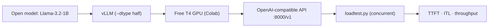

# Deploy an open-source LLM


Serve an open model behind an OpenAI-compatible API on a **free GPU**, then **measure**
how it performs. This is what "it works in production" actually means: an endpoint plus
numbers.

## Architecture



## What this demonstrates
- **vLLM** / **SGLang** serving · **GPU memory** budgeting
- measuring **TTFT**, **inter-token latency**, **throughput** under concurrency

## 1. Serve the model (on a GPU)
In **Google Colab** → *Runtime → Change runtime type → T4 GPU*, then:
```bash
!bash serve_colab.sh
```
This installs vLLM and serves `unsloth/Llama-3.2-1B-Instruct` on port 8000
(`--dtype half` because the T4 has no bf16). Endpoint: `http://localhost:8000/v1`.

### Which model fits a free T4 (~15 GB)?
| Model | Size | ~fp16 memory | Free T4? |
|-------|------|--------------|----------|
| Llama-3.2-1B-Instruct | 1B | ~2.5 GB | ✅ start here |
| Qwen3-4B | 4B | ~8 GB | ✅ |
| any 8B model | 8B | ~16 GB | use 4-bit AWQ |

Rule of thumb: **~2 GB per billion parameters** in fp16, plus room for the KV cache
(which grows with context length and concurrent users).

## 2. Load-test it (from any machine)
```bash
pip install -r requirements.txt
python loadtest.py --model unsloth/Llama-3.2-1B-Instruct --n 20 --concurrency 4
```
If testing a remote Colab server, expose it (e.g. cloudflared / ngrok) and pass
`--base-url https://<your-tunnel>/v1`.

## Results

> Run the load test and paste your numbers here.

| Model | GPU | Concurrency | TTFT p50 | ITL p50 | Aggregate TPS |
|-------|-----|-------------|----------|---------|---------------|
| Llama-3.2-1B-Instruct | T4 (Colab) | 4 | `__ ms` | `__ ms` | `__ tok/s` |

## "Done when" checklist
- [ ] You have a working endpoint
- [ ] You ran a load test against it
- [ ] This README shows your TTFT, latency and throughput

## Start here
vLLM docs — *Production Metrics* (free): https://docs.vllm.ai/en/latest/usage/metrics.html

---
<sub>Part of a 3-part AI-engineering series by **Ayoub AMRANI** ·
[rag-over-your-docs](https://github.com/yurri775/rag-over-your-docs) ·
[ai-agent-long-horizon](https://github.com/yurri775/ai-agent-long-horizon)</sub>
